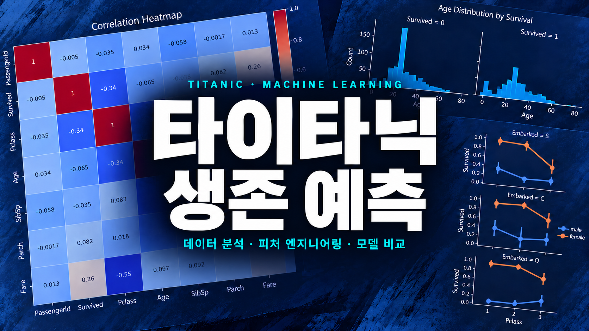
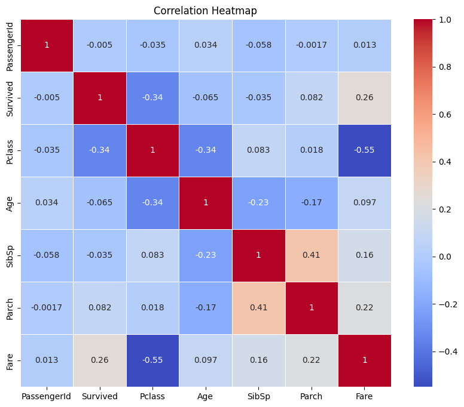
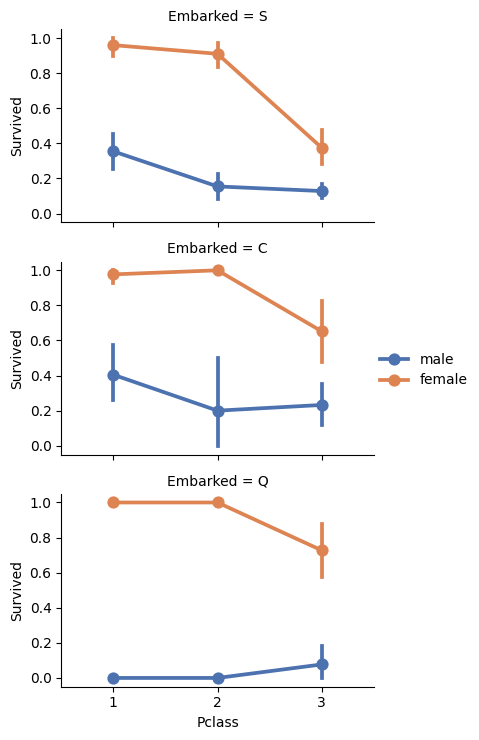

<div align="center">

# 타이타닉 승객 생존 여부 예측

<p align="center">
  
</p>

</div>

**데이터를 살펴보고, 예측에 사용할 특징을 구성하고, 여러 머신러닝 모델을 비교한 데이터사이언스 수업 텀 프로젝트입니다.**

타이타닉 승객의 객실 등급, 성별, 나이, 동승 가족 정보 등을 이용해 생존 여부를 예측했습니다. 데이터를 처음 확인하는 단계부터 결측치 처리, 탐색적 데이터 분석, 피처 엔지니어링, 모델 학습과 비교, 최종 예측 파일 생성까지 하나의 노트북에서 진행했습니다.

사용 기술은 **Python, pandas, NumPy, Matplotlib, seaborn, scikit-learn**이며, 분석 코드는 [`Notebook/titanic.ipynb`](Notebook/titanic.ipynb)에 있습니다.

## Contents

- [데이터 구성과 예측 목표](#데이터-구성과-예측-목표)
- [결측치 처리](#결측치-처리)
- [탐색적 데이터 분석](#탐색적-데이터-분석)
- [피처 엔지니어링](#피처-엔지니어링)
- [모델 학습 및 비교](#모델-학습-및-비교)
- [결론 및 회고](#결론-및-회고)

<br>

## 데이터 구성과 예측 목표

[Kaggle Titanic 데이터](https://www.kaggle.com/competitions/titanic/data)를 사용했습니다. 학습 데이터인 `train.csv`에는 승객 891명의 정보와 생존 여부가 있고, 테스트 데이터인 `test.csv`에는 생존 여부가 없는 승객 418명의 정보가 있습니다.

예측할 정답은 `Survived` 열입니다. `0`은 사망, `1`은 생존을 뜻하며, 승객 한 명을 두 범주 중 하나로 분류하는 이진 분류 문제입니다. 이미 정답이 있는 승객 정보로 모델을 학습한 뒤, 정답이 주어지지 않은 테스트 승객의 생존 여부를 예측했습니다.

먼저 `head()`, `info()`, `describe()`로 데이터의 형태, 열별 자료형, 값의 분포를 확인했습니다. 객실 등급인 `Pclass`는 숫자가 작을수록 높은 등급이고, `SibSp`와 `Parch`는 각각 함께 탑승한 형제자매·배우자 수와 부모·자녀 수입니다. `Embarked`는 탑승항을 나타냅니다. 숫자로 저장되어 있어도 등급이나 범주를 뜻하는 열이 있으므로, 값의 의미부터 구분했습니다.

`PassengerId`는 승객을 식별하는 번호로 남겨 두었다가 학습 입력에서 제외했습니다. 이후 예측 결과를 원래 승객과 연결할 때 다시 사용했습니다.

<br>

## 결측치 처리

모든 승객의 정보가 완전하게 기록되어 있지는 않았습니다. 학습 데이터에서는 나이 177개, 객실 번호 687개, 탑승항 2개가 비어 있었습니다. 테스트 데이터에도 나이와 객실 번호의 결측치가 있었고, 요금 1개가 추가로 비어 있었습니다.

결측치는 열의 특성에 따라 다르게 처리했습니다.

| 열 | 처리 방법 |
| --- | --- |
| `Age` | 학습 데이터와 테스트 데이터 각각의 나이 중앙값으로 채움 |
| `Cabin` | 양쪽 데이터에서 열을 제거 |
| `Embarked` | 학습 데이터의 결측치를 가장 자주 등장하는 탑승항으로 채움 |
| `Fare` | 테스트 데이터의 결측치를 테스트 데이터 요금의 중앙값으로 채움 |

나이와 요금의 빈 값은 각 열의 중앙값으로 일괄 대체했습니다. 중앙값은 값을 크기순으로 놓았을 때 가운데에 있는 값입니다. 탑승항에는 범주 중 가장 많이 등장한 값인 최빈값을 사용했습니다. `Cabin`은 학습 데이터 891개 중 687개가 비어 있어 분석에 사용할 열에서 제외했습니다.

처리 후에는 `isnull().sum()`으로 각 열에 결측치가 남아 있는지 다시 확인했습니다. 이렇게 빈 값을 정리한 데이터를 다음 분석과 특징 구성에 사용했습니다.

<br>

## 탐색적 데이터 분석

데이터의 내용을 이해하기 위해 통계와 그래프를 확인하는 탐색적 데이터 분석을 진행했습니다. 먼저 아래 [상관관계 히트맵](Resources/01_CorrelationHeatmap.png)으로 숫자형 열 사이의 관계를 살펴봤습니다.

<p align="center">
  
</p>

`Survived`와 `Pclass`의 상관계수는 약 `-0.34`, `Fare`와는 약 `0.26`으로 나타났습니다. 객실 등급은 숫자가 작을수록 높으므로, 이 데이터에서는 높은 객실 등급과 높은 요금이 생존 여부와 관련되는 방향을 보였습니다. 다만 이 값만으로 생존의 원인을 설명할 수는 없고, 이 시점의 히트맵에는 문자열로 저장된 성별과 탑승항도 포함되어 있지 않습니다.

이어서 객실 등급, 성별, 동승 가족 수별로 묶어 생존율을 비교했습니다. `Survived`가 `0`과 `1`로 표현되어 있어, 각 집단에서 이 열의 평균을 구하면 해당 집단의 생존 비율이 됩니다.

```python
train[['Pclass', 'Survived']] \
    .groupby('Pclass', as_index=False) \
    .mean() \
    .sort_values(by='Survived', ascending=False)
```

나이에 대해서는 생존자와 사망자의 분포를 나누어 보고, 다시 객실 등급별로 나눠 살펴봤습니다. 나이 전체를 한 번에 보는 것에 더해, 등급이라는 조건을 함께 놓고 분포를 확인했습니다. 이 그래프들은 [나이와 생존 여부](Resources/02_AgeBySurvival.png), [객실 등급별 나이와 생존 여부](Resources/03_AgeByPclassSurvival.png)에 정리되어 있습니다. 앞에서 결측 나이를 중앙값으로 채웠으므로 이 분포에는 대체한 값도 포함됩니다.

탑승항에 대해서도 객실 등급과 성별을 함께 구분해 생존율을 비교했습니다.

<p align="center">
  
</p>

그래프에서는 여러 집단에 걸쳐 여성의 생존율이 남성보다 높고, 객실 등급에 따라서도 차이가 나타납니다. 탑승항 하나의 평균만 보는 대신 성별과 등급을 함께 구분하면서, 같은 항구에서 탑승했더라도 집단별로 다른 경향이 있음을 확인했습니다. 이 분석을 통해 승객의 정보를 개별 값으로만 보지 않고, 다른 정보와 연결해서 살펴보았습니다.

<br>

## 피처 엔지니어링

분석한 데이터를 모델에 넣기 위해 필요한 정보를 추출하고 변환하는 피처 엔지니어링을 진행했습니다. 여기서 피처는 모델이 예측의 근거로 사용하는 입력 변수입니다.

### 이름에서 호칭 추출

이름 전체를 그대로 사용하지 않고 `Mr`, `Miss`, `Mrs`, `Master`와 같은 호칭을 추출해 `Title`을 만들었습니다. 드물게 등장하는 여러 호칭은 `Rare`로 묶었고, `Mlle`와 `Ms`는 `Miss`로, `Mme`는 `Mrs`로 통합했습니다. 이후 호칭을 숫자로 대응시켰습니다.

이렇게 이름이라는 긴 문자열에서 공통으로 비교할 수 있는 정보를 꺼낸 뒤 원래 `Name` 열을 제거했습니다. `Ticket`도 입력에서 제외했습니다.

### 가족 규모와 단독 탑승 여부

`SibSp`와 `Parch`를 합치고 본인 한 명을 더해 동승 가족 규모인 `FamilySize`를 만들었습니다. 여기에 가족 규모가 1이면 `1`, 그보다 크면 `0`이 되는 `IsAlone`을 추가했습니다.

```python
train['FamilySize'] = train['SibSp'] + train['Parch'] + 1
train['IsAlone'] = (train['FamilySize'] == 1).astype(int)
```

앞선 분석에서는 `SibSp`와 `Parch`를 각각 묶어 생존율을 살펴봤습니다. 입력을 구성할 때는 이 두 정보를 합쳐, `FamilySize`로 가족의 전체 규모를 표현하고 `IsAlone`으로 동승 가족이 없는지를 구분했습니다. 이후 원래 `SibSp`, `Parch` 열은 제거했고, 테스트 데이터에도 같은 계산을 적용했습니다.

### 나이와 요금 구간화

나이는 `pd.cut(..., 5)`로 값의 범위를 다섯 구간으로 나누어 `AgeBand`를 만들었습니다. 요금은 `pd.qcut(..., 4)`로 각 구간에 비슷한 수의 승객이 들어가도록 네 구간으로 나누어 `FareBand`를 만들었습니다. 두 열에는 구간 번호를 저장하고, 원래 `Age`, `Fare` 열은 제거했습니다.

연속적인 숫자를 구간으로 바꾸면 개별 값의 세밀한 차이는 사라지지만, 비슷한 범위의 승객을 같은 범주로 표현할 수 있습니다. 현재 노트북은 학습 데이터와 테스트 데이터에서 구간을 각각 계산합니다. 따라서 두 데이터에서 같은 구간 번호가 반드시 같은 나이·요금 범위를 뜻하지는 않는다는 한계가 있습니다.

마지막으로 성별과 탑승항을 숫자로 변환했습니다. 최종 학습 입력은 다음 8개 열입니다.

| 입력 변수 | 표현하는 정보 |
| --- | --- |
| `Pclass` | 객실 등급 |
| `Sex` | 성별 |
| `Embarked` | 탑승항 |
| `Title` | 이름에서 추출한 호칭 |
| `FamilySize` | 본인을 포함한 동승 가족 규모 |
| `IsAlone` | 동승 가족이 없는지 여부 |
| `AgeBand` | 나이 구간 |
| `FareBand` | 요금 구간 |

`Survived`는 예측할 정답으로 따로 분리했습니다. 학습 입력은 891행·8열, 테스트 입력은 418행·8열로 맞췄습니다. 여기까지는 승객 정보를 모델에 넣을 형태로 구성한 과정이며, 각 파생 변수가 정확도를 얼마나 바꾸는지는 별도 비교하지 않았습니다.

<br>

## 모델 학습 및 비교

구성한 8개 특징을 로지스틱 회귀, K-최근접 이웃, 가우시안 나이브 베이즈, 결정 트리, 랜덤 포레스트에 동일하게 입력했습니다. K-최근접 이웃은 이웃 수를 3으로, 랜덤 포레스트는 결정 트리 수를 100개로 설정했습니다.

모델은 `fit()`으로 학습하고 `predict()`로 테스트 데이터의 생존 여부를 예측했습니다. 비교 점수는 `score(X_train, Y_train)`으로 계산했습니다. **아래 수치는 노트북에 저장된 학습 데이터 정확도이며, 별도 검증 데이터나 Kaggle 제출 점수가 아닙니다.**

| 모델 | 학습 정확도 |
| --- | ---: |
| 로지스틱 회귀 | 81.03% |
| K-최근접 이웃 (`n_neighbors=3`) | 85.19% |
| 가우시안 나이브 베이즈 | 80.13% |
| 결정 트리 | 88.66% |
| 랜덤 포레스트 (`n_estimators=100`) | 88.66% |

기록된 학습 정확도에서는 결정 트리와 랜덤 포레스트가 같은 값으로 가장 높았습니다. 최종 예측 파일에는 랜덤 포레스트의 결과를 사용했습니다. 테스트 승객의 `PassengerId`와 예측한 `Survived`를 연결해 `submission.csv`로 저장했습니다.

```python
submission = pd.DataFrame({
    'PassengerId': test['PassengerId'],
    'Survived': Y_pred
})
submission.to_csv('submission.csv', index=False)
```

노트북을 위에서부터 실행하면 마지막으로 `Y_pred`에 들어가는 값이 랜덤 포레스트의 예측입니다. 최종 파일은 테스트 승객 418명의 식별 번호와 예측 결과를 담는 형태입니다.

다만 학습에 사용한 데이터를 다시 평가했으므로, 이 비교만으로 새로운 승객에 대한 예측 성능까지 판단할 수는 없습니다. 검증 데이터 분리와 교차 검증은 구현하지 않았습니다. 또한 트리 모델의 난수 시드를 고정하지 않아 재실행 시 결과가 달라질 수 있습니다. 다음 실험에서는 학습 데이터에서 정한 전처리 기준을 검증·테스트 데이터에도 적용하고, 교차 검증으로 모델을 비교할 필요가 있습니다.

<br>

## 결론 및 회고

처음에는 데이터가 주어져도 무엇부터 확인해야 할지 막연했습니다. 각 열의 의미를 살펴보고, 비어 있는 값은 어떻게 처리할지 정하고, 그래프와 집계로 경향을 확인하면서 데이터를 다루는 순서를 경험할 수 있었습니다. 이름에서 호칭을 꺼내거나 가족 정보를 합치는 과정에서는 원래 주어진 값을 예측에 사용할 특징으로 다시 구성해 보았습니다.

이렇게 처리한 데이터를 모델의 입력과 정답으로 나누고, 학습한 모델로 생존 여부를 예측하면서 앞의 작업들이 하나의 흐름으로 연결되었습니다. 데이터에서 의미 있는 정보를 찾고, 그것을 예측에 사용할 수 있는 형태로 만들어 가는 논리를 배웠다는 점에서 좋은 경험이었습니다.
