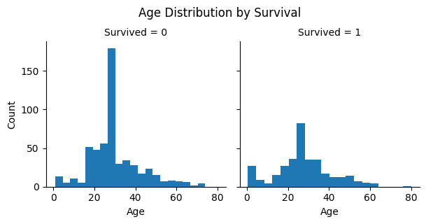
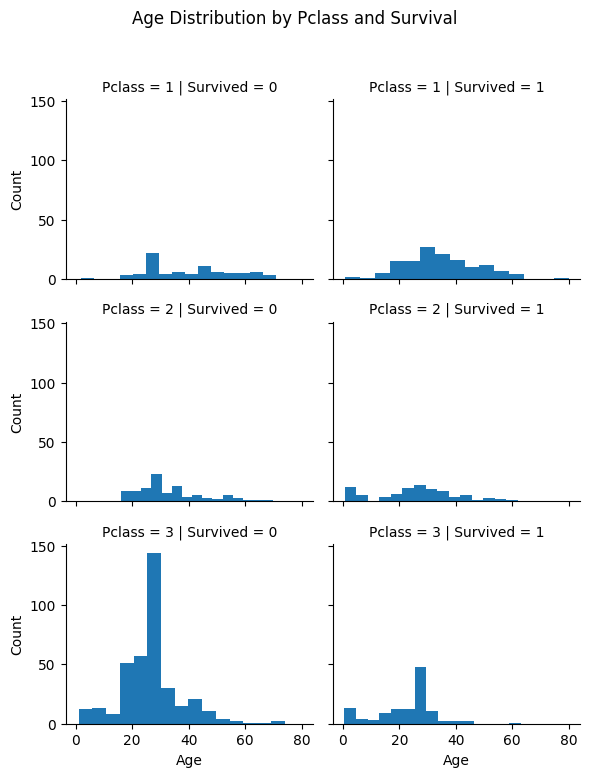

# Titanic Survival Prediction


> 한 학기 동안 데이터 사이언스를 배우며 익힌 데이터 수집, pandas 전처리, 탐색적 데이터 분석(EDA), 머신러닝 분류 모델을 Kaggle 타이타닉 생존자 예측 문제 하나에 적용했습니다.


## 프로젝트 소개

데이터사이언스 과목(2025년 1학기)의 기말 과제로 수행한 Kaggle [Titanic – Machine Learning from Disaster](https://www.kaggle.com/competitions/titanic) 분석입니다. 승객 정보(객실 등급, 성별, 나이, 동승 가족 수, 요금, 탑승항)로 생존 여부를 예측합니다.

분석은 네 단계로 진행했습니다.

1. **데이터 이해와 결측치 처리**: 변수 유형을 나누고 Age, Cabin, Embarked, Fare의 결측치를 처리합니다.
2. **탐색적 데이터 분석**: 가설을 세우고 그룹별 생존율과 시각화로 확인합니다.
3. **피처 엔지니어링**: 이름에서 호칭(Title)을 뽑고, 가족 수와 나이·요금 구간 변수를 만듭니다.
4. **모델링**: 분류 모델 5종을 학습하고 랜덤 포레스트로 제출 파일을 만듭니다.

- 작성자: 안지우 (부경대학교 컴퓨터공학과 4학년)
- 노트북: [`Notebook/titanic.ipynb`](Notebook/titanic.ipynb)

## 학습 과정

타이타닉 분석에 쓴 기술은 매주 과제로 하나씩 익혔습니다.

| 시기 | 주제 | 내용 | 타이타닉에서 쓰인 곳 |
|---|---|---|---|
| 1주 | 파일 입출력 | 텍스트 파일 쓰기·추가·읽기 모드 | 데이터 불러오기 |
| 2주 | JSON·XML | YouTube API 응답(JSON)과 Google 연관 검색어 API(XML)를 `requests`, `BeautifulSoup`로 파싱 | 데이터 수집 |
| 3주 | pandas 기초 | DataFrame, Series, 인덱싱, 행·열 선택 | 전체 전처리 |
| 4~5주 | pandas 데이터 처리와 EDA | COVID-19 일별 데이터로 결측치, 집계, 정렬, 탐색적 데이터 분석 과정 실습 | 결측치 처리, `groupby` 생존율 비교 |
| 6주 | 실전 데이터 처리 | 여러 날짜의 CSV를 합쳐 국가별 시계열 만들기, 브라질 이커머스(Olist) 고객 데이터 연습 문제 | 파생 변수, `value_counts`, `groupby` |
| 7주 | 통계적 가설 검정 | t-검정, 카이제곱 검정, 귀무가설과 대립가설 | 가설을 세우고 데이터로 확인하는 흐름 |
| 이후 | 선형 회귀 | 오렌지 무게로 가격을 예측하는 단순 선형 회귀 (`LinearRegression`) | 지도 학습 모델의 학습과 예측 |
| 이후 | Kaggle 자전거 공유 수요 예측 | 날짜·시간을 시간대·요일·월 피처로 분해, 선형·Lasso·Ridge·랜덤 포레스트·XGBoost 회귀와 스태킹 | 피처 분해, 여러 모델 비교, Kaggle 제출 |
| **기말** | **타이타닉 생존자 예측** | **EDA, 피처 엔지니어링, 분류 모델 비교** | |

## 주요 내용

### 1. 데이터 이해와 결측치 처리

학습 데이터는 891명, 테스트 데이터는 418명입니다. 먼저 변수를 유형별로 나눴습니다.

| 유형 | 변수 |
|---|---|
| 범주형 | Survived, Sex, Embarked |
| 순서형 | Pclass |
| 연속형 | Age, Fare |
| 이산형 | SibSp, Parch |

| 변수 | 결측치 (학습 / 테스트) | 처리 |
|---|---|---|
| Age | 177 / 86 | 중앙값으로 대체 |
| Cabin | 687 / 327 | 대부분 비어 있어 열 삭제 |
| Embarked | 2 / 0 | 최빈값(S)으로 대체 |
| Fare | 0 / 1 | 중앙값으로 대체 |

### 2. 탐색적 데이터 분석

수치형 변수끼리의 상관관계를 먼저 확인했습니다. 생존과 가장 관련이 큰 수치형 변수는 Pclass(−0.34)와 Fare(0.26)였습니다. Pclass와 Fare 사이의 상관(−0.55)도 커서, 둘이 비슷한 정보(경제적 지위)를 담고 있음을 알 수 있습니다.


이어서 네 가지 가설을 세우고 그룹별 평균 생존율로 확인했습니다.

| 가설 | 결과 | 판단 |
|---|---|---|
| 객실 등급이 높을수록 생존율이 높다 | 1등석 63.0%, 2등석 47.3%, 3등석 24.2% | 맞음 |
| 여성의 생존율이 더 높다 | 여성 74.2%, 남성 18.9% | 맞음. 가장 강한 변수 |
| 형제·배우자 수(SibSp)와 생존율은 관계가 있다 | 1명 53.6%, 0명 34.5%, 3명 이상 25% 이하 | 혼자보다 소가족이 높고, 대가족은 낮음 |
| 부모·자녀 수(Parch)와 생존율은 관계가 있다 | 1~3명 50~60%, 0명 34.4%, 4명 이상 20% 이하 | SibSp와 같은 경향 |

나이와 객실 등급을 함께 보면, 3등석의 20~30대 사망자가 특히 많습니다. 어린 아이들은 생존 쪽 비율이 상대적으로 높습니다.

| 나이별 생존 분포 | 객실 등급·나이별 생존 분포 |
|---|---|
|  |  |

탑승항, 객실 등급, 성별을 한 번에 비교하면 모든 조합에서 여성의 생존율이 남성보다 높습니다. 다만 1·2등석 여성의 생존율은 90% 이상인 반면, 3등석 여성은 탑승항에 따라 37~73%로 떨어집니다. 성별과 객실 등급이 함께 작용한다는 것을 보여 줍니다.

### 3. 피처 엔지니어링

| 작업 | 변수 | 방법 |
|---|---|---|
| 새 변수 | Title | 이름에서 호칭(Mr, Miss, Mrs, Master)을 추출. 드문 호칭은 Rare로 묶고 Mlle·Ms는 Miss, Mme는 Mrs로 통합 |
| 새 변수 | FamilySize | SibSp + Parch + 1 |
| 새 변수 | IsAlone | FamilySize가 1이면 1 |
| 구간화 | AgeBand | Age를 같은 폭 5개 구간으로 나눔 (`pd.cut`) |
| 구간화 | FareBand | Fare를 사분위 4개 구간으로 나눔 (`pd.qcut`) |
| 인코딩 | Sex, Embarked | 숫자로 매핑 |
| 삭제 | Name, Ticket, SibSp, Parch, Age, Fare | 새 변수로 대체했거나 식별자에 가까운 변수 |

호칭은 성별, 나이, 결혼 여부를 한 번에 담고 있어 생존율 차이가 뚜렷했습니다.

| Title | Mrs | Miss | Master | Rare | Mr |
|---|---|---|---|---|---|
| 생존율 | 79.4% | 70.3% | 57.5% | 34.8% | 15.7% |

최종적으로 Pclass, Sex, Embarked, Title, FamilySize, IsAlone, AgeBand, FareBand 8개 변수를 모델 입력으로 사용했습니다.

### 4. 모델링

분류 모델 5종을 같은 입력으로 학습했습니다.

| 모델 | 학습 데이터 정확도 |
|---|---|
| 랜덤 포레스트 (`n_estimators=100`) | 88.66% |
| 결정 트리 | 88.66% |
| K-최근접 이웃 (`k=3`) | 85.19% |
| 로지스틱 회귀 | 81.03% |
| 가우시안 나이브 베이즈 | 80.13% |

랜덤 포레스트와 결정 트리의 점수가 가장 높았고, 여러 트리의 결과를 모으는 랜덤 포레스트로 테스트 데이터의 생존 여부를 예측해 `submission.csv`를 만들었습니다.

## 돌아보며

과제를 마친 뒤 다시 살펴보니 개선할 점이 보였습니다.

| 문제 | 내용 | 개선 방향 |
|---|---|---|
| 평가 방법 | 위 정확도는 학습에 쓴 데이터로 잰 값이라 과적합 여부를 알 수 없습니다. 결정 트리와 랜덤 포레스트가 같은 88.66%인 것도 학습 데이터를 거의 외웠기 때문일 수 있습니다. | K-겹 교차 검증(`cross_val_score`)이나 검증 세트로 성능 비교 |
| 구간 기준 | AgeBand와 FareBand를 학습·테스트 데이터에서 따로 계산해, 같은 구간 번호가 서로 다른 범위를 뜻할 수 있습니다. 결측치 중앙값도 각각 따로 구했습니다. | 구간 경계와 대체값은 학습 데이터에서 구하고 테스트 데이터에 그대로 적용 |
| 나이 대체 | 결측치 177개를 모두 중앙값(28세)으로 채워, 나이 히스토그램의 28세 부근에 막대가 비정상적으로 솟았습니다. | 호칭(Title)이나 객실 등급별 중앙값으로 대체 |
| 모델 조합 | 단일 모델만 사용했습니다. | 여러 모델을 결합하는 앙상블 시도 |

## 실행 방법

1. Kaggle [Titanic 대회 데이터 페이지](https://www.kaggle.com/competitions/titanic/data)에서 `train.csv`, `test.csv`, `gender_submission.csv`를 내려받아 `Notebook/` 폴더에 넣습니다.
2. 필요한 패키지를 설치합니다.
   ```bash
   pip install pandas numpy scikit-learn seaborn matplotlib jupyter
   ```
3. `Notebook/titanic.ipynb`를 열고 위에서부터 차례로 실행합니다.

## 저장소 구조

```
Titanic-Survival-Prediction/
├── Notebook/
│   └── titanic.ipynb
├── Resources/
│   ├── 01_CorrelationHeatmap.png
│   ├── 02_AgeBySurvival.png
│   ├── 03_AgeByPclassSurvival.png
│   └── 04_EmbarkedPclassSex.png
└── README.md
```
